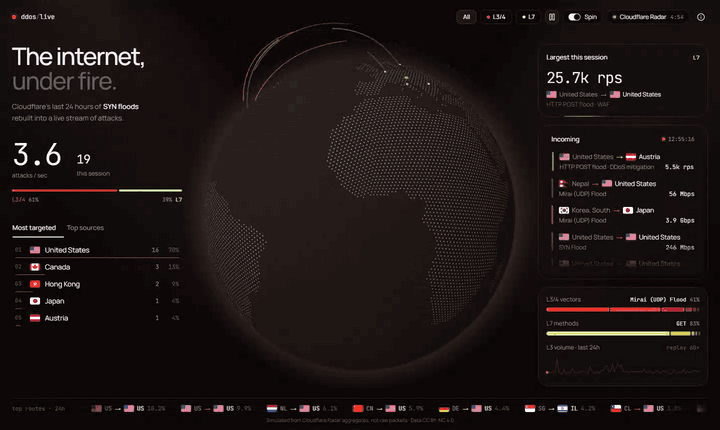
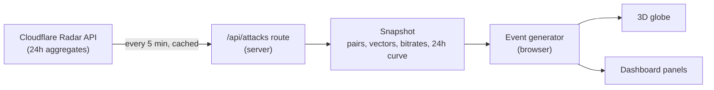

<div align="center">

# Live DDoS Attack Map

**A real-time 3D globe of DDoS attacks, rebuilt from Cloudflare Radar's aggregated data.**

[](https://nextjs.org)
[](https://react.dev)
[](https://www.typescriptlang.org)
[](https://tailwindcss.com)
[](https://radar.cloudflare.com)

<br />

<a href="docs/demo.mp4">
  
</a>

<br />

[About](#about) &nbsp;·&nbsp; [Features](#features) &nbsp;·&nbsp; [How it works](#how-it-works) &nbsp;·&nbsp; [Getting started](#getting-started) &nbsp;·&nbsp; [Deploy](#deploy-to-vercel) &nbsp;·&nbsp; [Configuration](#configuration) &nbsp;·&nbsp; [Project structure](#project-structure)

</div>

<br />

## About

Most "live attack maps" are either vendor marketing pieces or heavily staged. This project builds one from a real, public source: **Cloudflare Radar**, which publishes what Cloudflare's network actually mitigated over the last 24 hours.

There is one catch, and it shapes the whole design: Radar publishes **aggregates** (top country pairs, attack types, sizes, hourly volume), not a raw stream of individual attacks. So this app turns the aggregates back into a stream. Every arc on the globe is a single attack drawn at random from Cloudflare's real distributions, at a rate that follows the real 24-hour volume curve. Watch it for a few minutes and the totals, the busiest routes and the attack mix converge on what Cloudflare reported.

> **Honest framing:** this is a statistically faithful visualisation of recent real data, not a packet-level live feed. The page says so too.

## Features

<table>
  <tr>
    <td width="50%" valign="top">
      <strong>Live globe</strong><br />
      Attacks fly from source to target on a 3D globe, with an impact ripple on arrival. Orange is network layer (L3/4), lime is application layer (L7).
    </td>
    <td width="50%" valign="top">
      <strong>Real data, refreshed automatically</strong><br />
      Pulls fresh aggregates from the Cloudflare Radar API every 5 minutes. Server-side caching keeps API usage at about one call per 5 minutes, however many people are watching.
    </td>
  </tr>
  <tr>
    <td valign="top">
      <strong>Dashboard</strong><br />
      Attacks per second, session totals, most targeted countries and top sources, the largest attack seen, and a live incoming feed with country flags.
    </td>
    <td valign="top">
      <strong>Attack mix</strong><br />
      Breakdown of L3/4 vectors (SYN, UDP, DNS and so on) and L7 HTTP methods, plus the 24-hour volume curve with a playhead showing where the replay is.
    </td>
  </tr>
  <tr>
    <td valign="top">
      <strong>Controls</strong><br />
      Filter by layer (All, L3/4, L7), pause the stream, toggle globe rotation, and open a panel explaining how the data is built.
    </td>
    <td valign="top">
      <strong>Works without a token</strong><br />
      With no API key, or if Cloudflare is unreachable, the app falls back to clearly labelled sample data instead of breaking.
    </td>
  </tr>
</table>

## How it works



**1. Pull the aggregates (server).** The `/api/attacks` route asks Radar for the last 24 hours of data and caches the result for 5 minutes using Next.js `use cache`, plus a CDN cache header on Vercel.

| Data                                  | Radar endpoint                                                   |
| ------------------------------------- | ---------------------------------------------------------------- |
| L7 origin to target country pairs     | `/radar/attacks/layer7/top/attacks`                              |
| L3 attack pairs                       | `/radar/attacks/layer3/top/attacks`                              |
| L3 top origin and target locations    | `/radar/attacks/layer3/top/locations/{origin,target}`            |
| L3 vectors, protocols, bitrates       | `/radar/attacks/layer3/summary/{vector,protocol,bitrate}`        |
| L7 HTTP methods, mitigation products  | `/radar/attacks/layer7/summary/{http_method,mitigation_product}` |
| L3 volume over time (15-minute steps) | `/radar/attacks/layer3/timeseries`                               |

**2. Rebuild individual attacks (browser).** A weighted random sampler picks each attack's route, vector and size in proportion to Cloudflare's shares. Attacks arrive as a Poisson process, so timing looks natural rather than metronomic.

**3. Replay the day.** The arrival rate follows the real 24-hour volume curve, replayed at 60x speed (15 seconds per 15-minute bucket). Quiet and busy periods from the real day show up as calmer and heavier stretches on screen.

**4. Render efficiently.** New arcs are pushed straight into three-globe, bypassing React re-renders. Shader programs are kept alive so the globe never stutters when arcs come and go.

### Things worth knowing

- **L3 "origin" is a data center, not a country of attackers.** Source IPs in network-layer floods are usually spoofed, so Cloudflare attributes them to the data center that received the traffic.
- **L3 pairs may be approximated.** If Radar does not return direct origin to target pairs for L3, the app pairs top origins with top targets in proportion to their shares.
- **Data licence.** Cloudflare Radar data is CC BY-NC 4.0: attribution required, non-commercial use only.

## Getting started

### Prerequisites

- **Node.js 20.9 or newer** (required by Next.js 16)
- **npm** (or pnpm / yarn)
- A free **Cloudflare account** to create an API token (optional, see below)

### 1. Create a Cloudflare API token

1. Open [Cloudflare API tokens](https://dash.cloudflare.com/profile/api-tokens) and choose **Create Token**.
2. Choose **Create Custom Token**.
3. Add a single permission: **Account**, **Radar**, **Read**.
4. Create the token and copy it. You will not see it again.

> Skip this step to try the app on sample data first. You can add the token later.

### 2. Install and run

```bash
git clone https://github.com/0-two/Live-DDOS-Attack-Simulator.git
cd Live-DDOS-Attack-Simulator

npm install

cp .env.example .env.local
# open .env.local and paste your token:
# CLOUDFLARE_API_TOKEN=your_token_here

npm run dev
```

Open [http://localhost:3000](http://localhost:3000). The pill in the top right shows **Cloudflare Radar** when live data is flowing, or **Sample data** if no token is set. Hover it for the data window, last update time and any API errors.

### 3. Production build

```bash
npm run build
npm start
```

### Available scripts

| Command         | What it does                         |
| --------------- | ------------------------------------ |
| `npm run dev`   | Start the dev server with hot reload |
| `npm run build` | Create an optimised production build |
| `npm start`     | Serve the production build           |
| `npm run lint`  | Run ESLint                           |

## Configuration

| Setting                 | Where                                                | Default      | Purpose                                                 |
| ----------------------- | ---------------------------------------------------- | ------------ | ------------------------------------------------------- |
| `CLOUDFLARE_API_TOKEN`  | Environment variable                                 | none         | Radar API access. Without it the app shows sample data. |
| Server cache lifetime   | `cacheLife({ revalidate })` in `src/lib/radar.ts`    | 300 s        | How often the server asks Cloudflare for fresh data.    |
| Client refresh interval | `REFRESH_MS` in `src/hooks/use-attack-stream.ts`     | 5 min        | How often the browser re-fetches `/api/attacks`.        |
| Data window             | `RANGE` in `src/lib/radar.ts`                        | `1d`         | Time span of the aggregates (for example `7d`).         |
| Replay speed            | `REPLAY_SECONDS_PER_BUCKET` in `src/lib/simulate.ts` | 15           | Seconds of screen time per 15-minute Radar bucket.      |
| Average event rate      | `BASE_RATE` in `src/lib/simulate.ts`                 | 7 per second | Mean attacks per second at average intensity.           |
| Max arcs on screen      | `MAX_ACTIVE` in `src/hooks/use-attack-stream.ts`     | 70           | Upper bound on simultaneous arcs, for performance.      |

## Project structure

```text
src/
├── app/
│   ├── api/attacks/route.ts     API route serving the cached snapshot
│   ├── layout.tsx               Fonts, theme, Speed Insights
│   ├── page.tsx                 Entry point
│   └── icon.svg                 Favicon
├── components/
│   ├── attack-map.tsx           Page layout and state wiring
│   ├── dashboard/               Hero, stats, feed, tabs, peak card, ticker, controls
│   └── ui/                      Globe, shadcn/ui, Aceternity UI and Magic UI components
├── hooks/
│   └── use-attack-stream.ts     Polling, event loop, counters, globe feed
├── lib/
│   ├── radar.ts                 Cloudflare Radar client and caching
│   ├── simulate.ts              Weighted sampling and the replay clock
│   ├── geo.ts                   Country code to coordinates
│   ├── sample.ts                Fallback data
│   └── types.ts                 Shared types
└── data/                        Country polygons and centroids (Natural Earth)
```

<details>
<summary><strong>Regenerating the geographic data</strong></summary>

<br />

`src/data/globe.json` (country polygons) and `src/data/centroids.json` (per-country anchor points) are derived from the [Natural Earth](https://www.naturalearthdata.com) 110m countries dataset by `scripts/build-geo.mjs`:

```bash
node scripts/build-geo.mjs path/to/ne_110m_admin_0_countries.geojson
```

A handful of small states missing from the 110m dataset are added by hand in `src/lib/geo.ts`.

</details>

## Built with

|                   |                                                                                                                                                                                                                                                                                 |
| ----------------- | ------------------------------------------------------------------------------------------------------------------------------------------------------------------------------------------------------------------------------------------------------------------------------- |
| **Framework**     | [Next.js 16](https://nextjs.org) (App Router), [React 19](https://react.dev), [TypeScript](https://www.typescriptlang.org)                                                                                                                                                      |
| **3D**            | [three.js](https://threejs.org), [three-globe](https://github.com/vasturiano/three-globe), [React Three Fiber](https://r3f.docs.pmnd.rs)                                                                                                                                        |
| **Styling**       | [Tailwind CSS 4](https://tailwindcss.com), Manrope and JetBrains Mono via `next/font`                                                                                                                                                                                           |
| **UI components** | [shadcn/ui](https://ui.shadcn.com) (Tabs, Toggle Group, Tooltip, Hover Card, Sheet, Switch), [Aceternity UI](https://ui.aceternity.com) (Globe, Spotlight, Flip Words, Glowing Effect), [Magic UI](https://magicui.design) (Number Ticker, Animated List, Marquee, Border Beam) |
| **Animation**     | [Motion](https://motion.dev)                                                                                                                                                                                                                                                    |
| **Data**          | [Cloudflare Radar API](https://developers.cloudflare.com/radar/)                                                                                                                                                                                                                |
| **Flags**         | [flagcdn.com](https://flagcdn.com)                                                                                                                                                                                                                                              |

The Aceternity globe is adapted for streaming data, and the Magic UI Animated List item is lightly modified. Both changes are noted in the source.

## Acknowledgements

Attack data courtesy of [Cloudflare Radar](https://radar.cloudflare.com), licensed under [CC BY-NC 4.0](https://creativecommons.org/licenses/by-nc/4.0/). Country geometry from [Natural Earth](https://www.naturalearthdata.com) (public domain). This project is not affiliated with or endorsed by Cloudflare.
